# 01 — Arquitetura da Plataforma OestudoLiberta

> Documento técnico de referência. Descreve **o que** está sendo construído, **como** as peças
> se conectam e **em que ordem** cada serviço é implementado.
>
> Todos os diagramas usam [Mermaid](https://mermaid.js.org/) e renderizam automaticamente no
> VS Code (extensão *Markdown Preview Mermaid Support*) e no GitHub.

---

## 1. Visão geral (contexto e componentes)

Plataforma de cursos online com **pagamento por curso**, autenticação delegada ao Firebase,
vídeos hospedados na Cloudflare Stream e pagamentos via Mercado Pago.

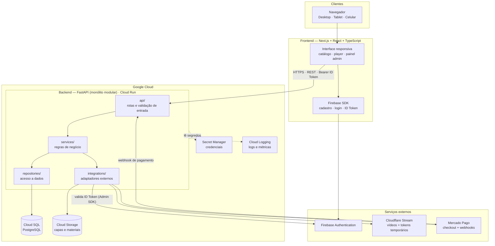

### Responsabilidade de cada componente

| Componente | Responsabilidade | Por que existe |
|---|---|---|
| **Navegador** | Exibe a interface em qualquer tamanho de tela | Usuário final acessa de PC, tablet ou celular |
| **Frontend (Next.js)** | Interface, navegação e chamadas à API | Separa apresentação de regra de negócio |
| **Firebase Authentication** | Cadastro, login, confirmação de e-mail, recuperação de senha e emissão do ID Token | Evita reconstruir autenticação (e seus riscos) do zero |
| **Backend (FastAPI)** | Regras de negócio, autorização, integrações | Fonte única de verdade; nunca confia no frontend |
| **PostgreSQL (Cloud SQL)** | Dados relacionais (usuários, cursos, compras, progresso) | Integridade transacional e relacional |
| **Cloud Storage** | Capas de curso e materiais complementares | Arquivos grandes fora do banco |
| **Cloudflare Stream** | Upload, transcodificação e entrega dos vídeos | Vídeo não é armazenado no servidor nem no banco |
| **Mercado Pago** | Processa o pagamento e notifica via webhook | Não lidamos com dados de cartão |
| **Secret Manager** | Guarda credenciais fora do código | Segredos não ficam no repositório |
| **Cloud Logging** | Centraliza logs e métricas | Diagnóstico e auditoria operacional |

---

## 2. Estilo arquitetural: monólito modular

Decisão consciente: **um único deploy de backend, internamente dividido em camadas com
responsabilidades claras**. Sem microsserviços nesta fase.

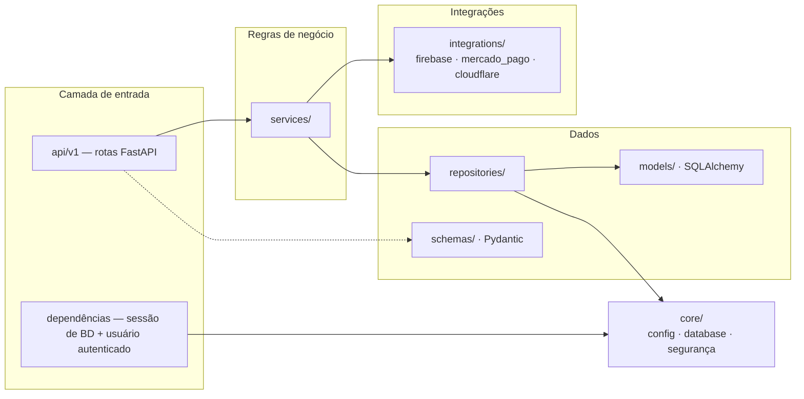

**Regra de dependência:** `api → services → repositories → models`. Nenhuma camada "pula"
para fora dessa direção. As integrações externas são sempre acessadas via `integrations/`,
para que possam ser trocadas (ou simuladas em testes) sem tocar na regra de negócio.

### 2.1 Estrutura de código implementada (backend)

```text
backend/
├── alembic.ini                     # configuração do Alembic (sem credenciais)
├── pyproject.toml                  # pytest · ruff
├── requirements.txt                # dependências fixadas
├── app/
│   ├── main.py                     # FastAPI · CORS · /health · /health/db · router v1
│   ├── core/
│   │   ├── config.py               # Settings (pydantic-settings) · lê o .env da raiz
│   │   ├── database.py             # engine · SessionLocal · Base + naming_convention
│   │   ├── enums.py                # domínios fechados (StrEnum) — ver 4.7
│   │   └── exceptions.py           # DomainError + handler central → HTTP — ver 3.5
│   ├── models/                     # mapeamento ORM (tabelas 4.2/4.3)
│   │   ├── base.py                 # mixins (Id/CreatedAt/Timestamp) + helper enum_type()
│   │   ├── user.py                 # Role · User
│   │   ├── content.py              # Category · Course · Lesson
│   │   ├── commerce.py             # Purchase · Payment · Enrollment
│   │   ├── learning.py             # LessonProgress
│   │   └── system.py               # WebhookEvent · AuditLog
│   ├── schemas/
│   │   ├── user.py                 # RoleRead · UserRead
│   │   ├── category.py             # CategoryCreate/Update/Read
│   │   ├── course.py               # CourseCreate/Update/Read
│   │   ├── lesson.py               # Lesson* + LessonVideoUploadRead · MAX_LESSON_SECONDS
│   │   ├── catalog.py              # contratos públicos da vitrine — ver 3.7
│   │   ├── learning.py             # contratos da área do aluno e do progresso — ver 3.8 · 3.11
│   │   └── purchase.py             # contratos do checkout e do histórico — ver 3.10
│   ├── api/
│   │   ├── deps.py                 # get_current_user · require_verified_email · require_admin
│   │   └── v1/
│   │       ├── router.py           # agrega as rotas da v1
│   │       └── routes/
│   │           ├── auth.py         # GET /auth/me
│   │           ├── users.py        # GET /users (ADMIN)
│   │           ├── categories.py   # CRUD /categories (ADMIN) — ver 3.5
│   │           ├── courses.py      # CRUD + publish/unpublish /courses (ADMIN)
│   │           ├── lessons.py      # CRUD /lessons + video-upload (ADMIN)
│   │           ├── catalog.py      # vitrine pública /catalog (sem autenticação) — ver 3.7
│   │           ├── me.py           # área do aluno /me (cursos, reprodução, progresso, histórico) — ver 3.8 · 3.11
│   │           ├── purchases.py    # POST /purchases (checkout) e GET /purchases — ver 3.10
│   │           └── webhooks.py     # POST /webhooks/mercadopago (público, assinado) — ver 3.10
│   ├── services/
│   │   ├── auth_service.py         # sync_user (Firebase → PostgreSQL) — ver 3.4
│   │   ├── user_service.py         # listagem de usuários
│   │   ├── category_service.py     # regras de categorias + auditoria
│   │   ├── course_service.py       # regras de cursos, publicação + auditoria
│   │   ├── lesson_service.py       # regras de aulas, ordem, upload de vídeo
│   │   ├── catalog_service.py      # leitura pública (só cursos publicados) — ver 3.7
│   │   ├── learning_service.py     # matrícula ativa · aulas publicadas · reprodução — ver 3.8
│   │   ├── progress_service.py     # progresso, conclusão e indicadores de aprendizagem — ver 3.11
│   │   ├── purchase_service.py     # criação da compra e do checkout — ver 3.10
│   │   └── payment_service.py      # webhook: idempotência · validação · liberação — ver 3.10
│   ├── repositories/
│   │   ├── role_repository.py      # busca de papel por nome
│   │   ├── user_repository.py      # busca por uid/e-mail · criação · listagem
│   │   ├── category_repository.py  # CRUD de categorias · listagem de ativas
│   │   ├── course_repository.py    # CRUD de cursos · contagens · consultas da vitrine
│   │   ├── lesson_repository.py    # CRUD de aulas · ordem/max_order · contagem por curso
│   │   ├── audit_repository.py     # gravação de trilha de auditoria
│   │   ├── enrollment_repository.py # matrículas por usuário/curso — ver 3.8 · 3.10
│   │   ├── lesson_progress_repository.py # progresso por aula e agregação por curso — ver 3.11
│   │   ├── purchase_repository.py  # compras por usuário e criação — ver 3.10
│   │   ├── payment_repository.py   # pagamentos por id externo do gateway — ver 3.10
│   │   └── webhook_repository.py   # registro idempotente de eventos — ver 3.10
│   └── integrations/
│       ├── firebase.py             # validação do ID Token (Firebase Admin SDK)
│       ├── cloudflare_stream.py    # upload direto + token de reprodução — ver 3.6 · 3.8
│       └── mercado_pago.py         # preferência de checkout · reconsulta · assinatura — ver 3.10
├── migrations/
│   ├── env.py                      # URL vinda de app.core.config · target = Base.metadata
│   ├── script.py.mako              # template das revisões
│   └── versions/                   # revisões versionadas (ver 4.6)
└── tests/
    ├── conftest.py                 # fixtures: sessão isolada + client HTTP
    ├── test_auth.py                # autenticação e autorização (Firebase mockado)
    ├── test_content.py             # categorias · cursos · aulas · upload de vídeo
    ├── test_catalog.py             # vitrine pública (categorias e cursos publicados)
    ├── test_learning.py            # área do aluno: meus cursos e reprodução — ver 3.8
    ├── test_progress.py            # progresso, conclusão, indicadores e histórico — ver 3.11
    ├── test_payments.py            # checkout · webhook idempotente · liberação — ver 3.10
    └── test_health.py              # /health e /health/db
```

**Mapeamento arquivo → tabelas:**

| Arquivo | Tabelas |
|---|---|
| [user.py](file:///c:/Users/c13_1/Projetos/OestudoLiberta/backend/app/models/user.py) | `roles`, `users` |
| [content.py](file:///c:/Users/c13_1/Projetos/OestudoLiberta/backend/app/models/content.py) | `categories`, `courses`, `lessons` |
| [commerce.py](file:///c:/Users/c13_1/Projetos/OestudoLiberta/backend/app/models/commerce.py) | `purchases`, `payments`, `enrollments` |
| [learning.py](file:///c:/Users/c13_1/Projetos/OestudoLiberta/backend/app/models/learning.py) | `lesson_progress` |
| [system.py](file:///c:/Users/c13_1/Projetos/OestudoLiberta/backend/app/models/system.py) | `webhook_events`, `audit_logs` |

> Os modelos são importados em `app/models/__init__.py` para que o `autogenerate` do Alembic
> os descubra. O `Base` (com a `naming_convention`) vive em `app/core/database.py` e é
> reexportado por `app/models/base.py`.

### 2.2 Estrutura de código implementada (frontend)

Next.js 16 (App Router, Turbopack) + React 19 + Tailwind CSS 4. O **acesso HTTP ao backend
acontece no servidor** (`src/lib/*`); o navegador só conversa com o Firebase Authentication.

```text
frontend/
├── next.config.ts                  # cacheComponents habilitado (PPR)
├── .env.local                      # NEXT_PUBLIC_FIREBASE_* · API base URL (não versionado)
└── src/
    ├── app/
    │   ├── layout.tsx              # layout raiz: Providers · SiteHeader · SiteFooter
    │   ├── providers.tsx           # agrupa os contextos de cliente
    │   ├── globals.css             # tema Tailwind (tokens de marca)
    │   ├── page.tsx                # home pública: destaque + categorias + cursos — ver 3.7
    │   ├── cursos/
    │   │   ├── page.tsx            # catálogo público (busca e filtro por categoria)
    │   │   └── [courseId]/page.tsx # detalhe do curso (aulas publicadas) — ver 3.7
    │   ├── dashboard/              # área do aluno: meus cursos + player — ver 3.8
    │   │   └── historico/          # indicadores e histórico de aprendizagem — ver 3.11
    │   ├── compras/retorno/        # retorno do checkout (não libera acesso) — ver 3.10
    │   ├── admin/                  # painel admin: cursos, categorias e aulas — ver 3.9
    │   ├── login/                  # autenticação (etapa 3.1)
    │   ├── cadastro/               # criação de conta (etapa 3.1)
    │   ├── recuperar-senha/        # redefinição de senha (etapa 3.1)
    │   └── verificar-email/        # confirmação de e-mail (etapa 3.1)
    ├── components/
    │   ├── layout/                 # SiteHeader · SiteFooter
    │   ├── catalog/                # CourseCard · CourseGrid · estados de carregamento/erro
    │   ├── learning/               # MyCourseCard · MyCourseGrid · MyCoursesEmpty (progresso) — ver 3.11
    │   ├── checkout/               # BuyCourseButton (inicia a compra) — ver 3.10
    │   ├── admin/                  # AdminShell · StatusBadge — ver 3.9
    │   └── ui/                     # Button · TextInput · TextAreaField · SelectField · Alert
    ├── contexts/auth-context.tsx   # sessão Firebase + sincronização com /auth/me
    ├── hooks/use-require-auth.ts   # guarda de rotas restritas (cliente)
    ├── lib/
    │   ├── env.ts                  # leitura das variáveis públicas + URL da API
    │   ├── api.ts                  # cliente HTTP do backend (erros tipados)
    │   ├── catalog.ts              # consultas do catálogo (somente servidor)
    │   ├── format.ts               # formatação de preço (pt-BR) e duração
    │   ├── cloudflare-upload.ts    # envio direto do vídeo à Cloudflare — ver 3.9
    │   └── firebase.ts             # inicialização do Firebase Web SDK
    ├── services/auth-service.ts    # chamadas de autenticação ao backend
    ├── services/learning-service.ts # chamadas /me/* (cursos, reprodução, progresso e histórico)
    ├── services/purchase-service.ts # chamadas /purchases (início da compra) — ver 3.10
    ├── services/admin-service.ts   # chamadas /categories · /courses · /lessons (ADMIN)
    └── types/api.ts                # contratos compartilhados com a API
```

**Rotas do frontend:**

| Rota | Tipo | Descrição |
|---|---|---|
| `/` | Pública (PPR) | Vitrine: destaque, categorias e cursos publicados |
| `/cursos` | Pública (PPR) | Catálogo com busca (`?q=`) e filtro (`?categoria=`) |
| `/cursos/[courseId]` | Pública | Detalhe do curso, aulas publicadas e botão de compra — ver 3.10 |
| `/compras/retorno` | Pública | Retorno do checkout; apenas informa o estado, **não** libera acesso — ver 3.10 |
| `/dashboard` | Restrita | Área do aluno: cursos liberados (ou estado vazio) — ver 3.8 |
| `/dashboard/cursos/[courseId]` | Restrita | Player do curso: aulas, reprodução e registro de progresso — ver 3.8 · 3.11 |
| `/dashboard/historico` | Restrita | Indicadores, cursos concluídos e continuidade de aprendizagem — ver 3.11 |
| `/admin` | Restrita (ADMIN) | Painel administrativo (redireciona para a gestão de cursos) — ver 3.9 |
| `/admin/categorias` | Restrita (ADMIN) | Cadastro, edição e remoção de categorias |
| `/admin/cursos` | Restrita (ADMIN) | Lista, criação, publicação e remoção de cursos |
| `/admin/cursos/[courseId]` | Restrita (ADMIN) | Edição do curso e gestão das aulas e vídeos |
| `/login` · `/cadastro` · `/recuperar-senha` · `/verificar-email` | Pública | Fluxos de autenticação (SPRINT 3.1) |

> **Cache Components (PPR).** `next.config.ts` habilita `cacheComponents`, então as páginas
> dinâmicas geram um *shell* estático e transmitem (*stream*) o conteúdo dependente da
> requisição. Dados que não podem ser pré-renderizados usam `connection()`
> (ver `src/lib/catalog.ts`) e componentes com valores voláteis usam `"use cache"` +
> `cacheLife()` (ver `site-footer.tsx`).

> **Limitação conhecida — soft-404 em `/cursos/[courseId]`.** Com o PPR, o shell começa a ser
> transmitido **antes** de o `notFound()` rodar, então uma URL de curso inexistente
> (ex.: `/cursos/999999`) responde com status **200** em vez de **404**. O Next injeta
> automaticamente `<meta name="robots" content="noindex">` (os buscadores não indexam) e a API
> do backend responde 404 corretamente. A alternativa para obter um 404 real seria validar o id
> em `src/proxy.ts` antes da renderização, ao custo de uma chamada extra ao backend por acesso —
> decisão adiada até existir uma necessidade concreta (SEO/analytics). Ids não numéricos
> (`/cursos/abc`) chamam `notFound()` na própria página e, por isso, não geram erro de backend.

---

## 3. Fluxos principais

### 3.1 Cadastro, login e sincronização do usuário

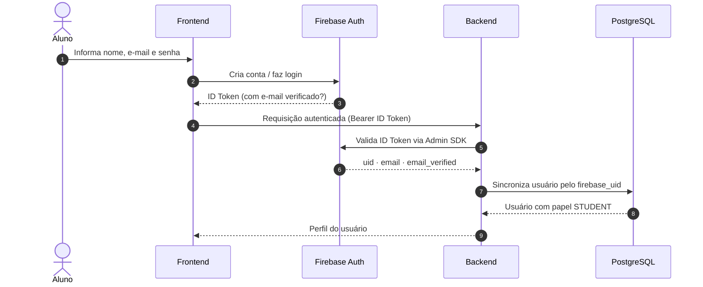

### 3.2 Compra de um curso

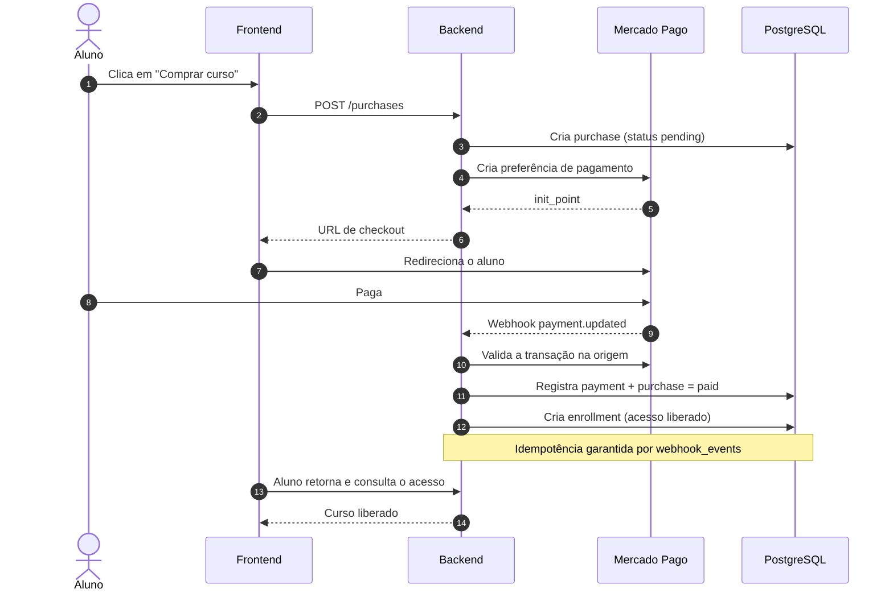

> **Regra de segurança:** o acesso **nunca** é liberado porque o navegador voltou de uma página
> de pagamento. A liberação depende exclusivamente do webhook validado.

### 3.3 Reprodução de aula em vídeo

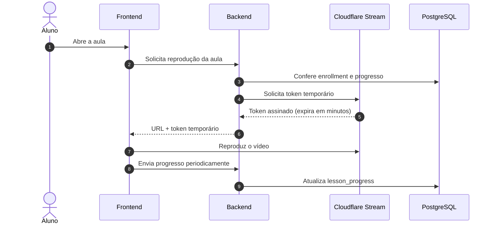

### 3.4 Autenticação e autorização (implementado na Etapa 1.4)

Toda rota privada passa pela mesma cadeia de dependências do FastAPI
([api/deps.py](file:///c:/Users/c13_1/Projetos/OestudoLiberta/backend/app/api/deps.py)):

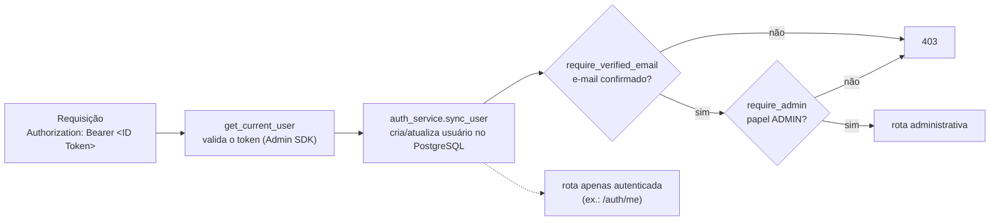

**Endpoints da v1:**

| Método | Rota | Acesso exigido | Descrição |
|---|---|---|---|
| `GET` | `/api/v1/auth/me` | autenticado | Perfil do usuário; sincroniza no primeiro acesso |
| `GET` | `/api/v1/users` | ADMIN + e-mail verificado | Lista os usuários da plataforma |

**Regras implementadas:**

- Token ausente, inválido, expirado ou revogado → **401**.
- Firebase não configurado no servidor → **503** (falha explícita, sem liberar acesso).
- Primeiro acesso cria o usuário com papel **STUDENT**; o e-mail igual a
  `ADMIN_BOOTSTRAP_EMAIL` é promovido a **ADMIN** (criação de administrador por configuração,
  nunca pelo próprio usuário).
- Usuário já existente: o **papel nunca é alterado** pela sincronização; apenas
  `email_verified` e `name` são espelhados do Firebase.
- Áreas restritas exigem **e-mail confirmado** → 403 caso contrário.
- **STUDENT** não acessa rotas de **ADMIN** → 403.

**Configuração necessária (variáveis de ambiente):** `FIREBASE_PROJECT_ID`,
`FIREBASE_CREDENTIALS_PATH` (JSON da conta de serviço, fora do versionamento — pasta `secrets/`)
e `ADMIN_BOOTSTRAP_EMAIL`.

### 3.5 Gestão de conteúdo (implementado na SPRINT 2)

Toda a gestão de conteúdo é **administrativa**. As rotas passam pela mesma cadeia da seção 3.4
(`AdminUser` = autenticado + e-mail verificado + papel ADMIN) e repassam o trabalho para os
services, que concentram as regras de negócio e gravam a trilha de auditoria.

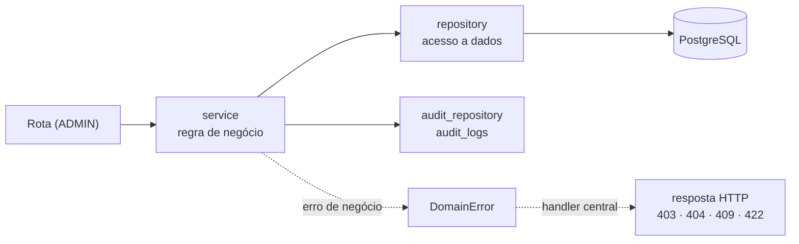

Fluxo de criação e publicação:

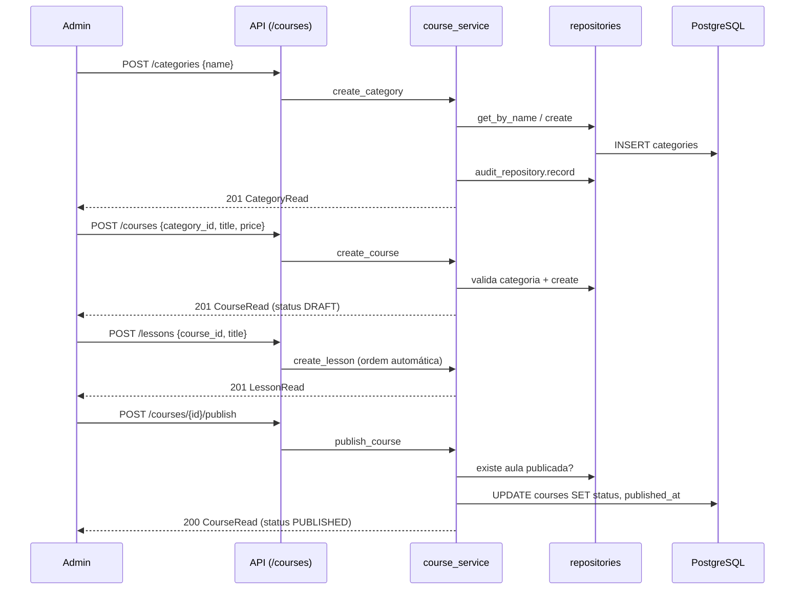

**Endpoints da v1 (conteúdo) — todos exigem ADMIN:**

| Método | Rota | Descrição |
|---|---|---|
| `GET` | `/api/v1/categories` | Lista categorias |
| `POST` | `/api/v1/categories` | Cria categoria |
| `GET` | `/api/v1/categories/{id}` | Detalha categoria |
| `PATCH` | `/api/v1/categories/{id}` | Atualiza categoria |
| `DELETE` | `/api/v1/categories/{id}` | Remove categoria (sem cursos vinculados) |
| `GET` | `/api/v1/courses` | Lista cursos (filtro `?status=`) |
| `POST` | `/api/v1/courses` | Cria curso (rascunho) |
| `GET` | `/api/v1/courses/{id}` | Detalha curso |
| `PATCH` | `/api/v1/courses/{id}` | Atualiza curso |
| `POST` | `/api/v1/courses/{id}/publish` | Publica curso |
| `POST` | `/api/v1/courses/{id}/unpublish` | Despublica curso |
| `DELETE` | `/api/v1/courses/{id}` | Remove curso (sem alunos matriculados) |
| `GET` | `/api/v1/lessons?course_id=` | Lista aulas do curso (filtro `?only_published=`) |
| `POST` | `/api/v1/lessons` | Cria aula (ordem automática se omitida) |
| `GET` | `/api/v1/lessons/{id}` | Detalha aula |
| `PATCH` | `/api/v1/lessons/{id}` | Atualiza aula (valida ordem) |
| `DELETE` | `/api/v1/lessons/{id}` | Remove aula |
| `POST` | `/api/v1/lessons/{id}/video-upload` | Negocia upload direto de vídeo |

**Regras de negócio implementadas:**

- Nome de categoria é **único** (duplicidade → 409).
- Categoria só é removida se **não tiver cursos** vinculados (→ 409).
- Curso nasce em `DRAFT` e com `published_at` nulo; `category_id` precisa existir (→ 422).
- Publicar exige **ao menos uma aula publicada** (→ 422) e grava `published_at`;
  despublicar devolve o curso a `DRAFT` e zera `published_at`.
- Curso só é removido se **não tiver matrículas** (→ 409).
- A ordem (`lesson_order`) é **única por curso**: se omitida, recebe `max(order) + 1`;
  se colidir → 409 (a unicidade também existe no banco: `uq_lessons_course_id_lesson_order`).
- Duração de aula ≤ **900 s** (validado no schema e no banco — `ck_lessons_duration_max_15_minutes`).
- Toda ação administrativa de conteúdo grava um registro em `audit_logs`
  (`category.create`, `course.publish`, `lesson.video_upload`, etc.).

### 3.6 Upload de vídeo (Cloudflare Stream)

O arquivo de vídeo **nunca passa pelo backend**. O serviço apenas negocia uma URL de upload de
uso único e guarda o `uid` do vídeo na aula.

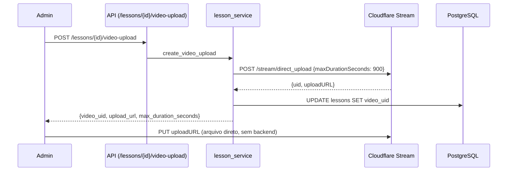

- Cloudflare não configurada (`CLOUDFLARE_ACCOUNT_ID` / `CLOUDFLARE_STREAM_API_TOKEN`) → **503**.
- Falha de comunicação ou resposta inesperada da Cloudflare → **502**.
- O token da API da Cloudflare **nunca** é exposto ao cliente; só a URL de upload de uso único.
- O limite de duração do upload é o mesmo da aula (15 minutos).

### 3.7 Catálogo público (implementado na SPRINT 3.2)

A vitrine é a única parte do backend **sem autenticação**: expõe somente conteúdo publicado e
omite campos internos (por exemplo, `video_uid` e `status`). As consultas usam `joinedload` na
categoria e uma contagem agregada de aulas, evitando o problema de N+1.

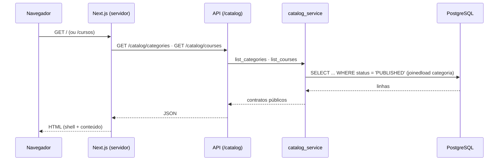

**Endpoints públicos (sem autenticação):**

| Método | Rota | Descrição |
|---|---|---|
| `GET` | `/api/v1/catalog/categories` | Categorias **ativas**, em ordem alfabética |
| `GET` | `/api/v1/catalog/courses` | Cursos **publicados** (filtros `?category_id=` e `?search=`) |
| `GET` | `/api/v1/catalog/courses/{id}` | Detalhe do curso com as aulas **publicadas** (404 se não publicado) |

**Regras de exposição:**

- Somente cursos com `status = PUBLISHED` aparecem; rascunhos nunca são listados (→ 404 no detalhe).
- Categorias inativas são omitidas da vitrine.
- Apenas aulas publicadas são exibidas na página do curso; `video_uid` nunca é enviado ao cliente.
- `search` é case-insensitive (`ILIKE` sobre o título); a listagem ordena por `published_at` decrescente.
- `lessons_count` acompanha cada item da listagem para exibir a quantidade de aulas no card.
- A vitrine depende de o backend estar no ar durante a requisição; indisponibilidade → mensagem de
  erro amigável na página (o build/prerender **não** depende do backend).

---

### 3.8 Área do aluno (implementado na SPRINT 3.3)

A área do aluno é a contrapartida privada da vitrine. Toda leitura exige **autenticação com
e-mail confirmado** (`VerifiedUser`) **e** uma matrícula `ACTIVE` naquele curso — a posse de
um `course_id` não dá acesso a nada. `video_uid` **nunca** sai do backend: o cliente recebe
apenas URLs assinadas, geradas na hora e válidas por 1 hora.

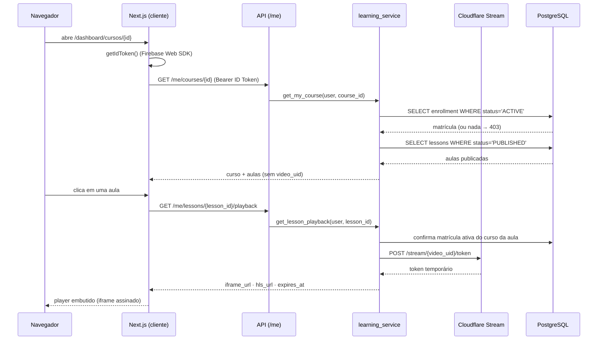

**Endpoints do aluno (autenticados + e-mail verificado):**

| Método | Rota | Descrição |
|---|---|---|
| `GET` | `/api/v1/me/courses` | Cursos com matrícula `ACTIVE` do usuário (lista; vazia se não houver) |
| `GET` | `/api/v1/me/courses/{id}` | Curso liberado com as aulas **publicadas** (403 sem matrícula) |
| `GET` | `/api/v1/me/lessons/{id}/playback` | Token temporário de reprodução da aula |

**Regras de acesso:**

- Sem matrícula `ACTIVE` no curso: `403 Forbidden` (mesmo que o curso exista e seja público).
- Apenas aulas `PUBLISHED` são listadas/reproduzíveis; rascunhos → `404`.
- Aula sem `video_uid`: `422` — "Esta aula ainda não tem vídeo disponível."
- Cloudflare Stream não configurada: `503`; falha da Cloudflare: `502`.
- O token de reprodução é emitido por requisição e expira em 1 hora (`expires_at`).
- `video_uid` não aparece em nenhuma resposta (verificado em `tests/test_learning.py`).
- A listagem de cursos mostra o estado vazio enquanto o usuário não tem matrículas — situação
  esperada para quem ainda não comprou; as matrículas passaram a ser criadas pelo webhook de
  pagamento na SPRINT 4 (ver 3.10).

**Configuração necessária:** além de `CLOUDFLARE_ACCOUNT_ID` e `CLOUDFLARE_STREAM_API_TOKEN`,
a reprodução exige `CLOUDFLARE_STREAM_CUSTOMER_CODE` (o subdomínio
`customer-<CODE>.cloudflarestream.com` exibido no painel do Stream), usado para montar as
URLs assinadas.

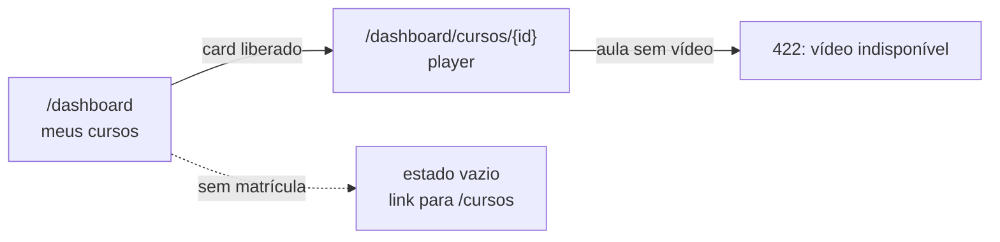

---

### 3.9 Área administrativa (implementado na SPRINT 3.4)

O painel administrativo é a **interface** das rotas ADMIN que já existiam no backend desde a
SPRINT 2. Nenhuma regra de negócio nova foi criada: o frontend apenas orquestra chamadas que o
servidor já validava (papel ADMIN, posição única das aulas, limite de 15 minutos, remoção com
vínculos ativos, curso publicado exigindo aula publicada). Por isso é uma área restrita e
marcada com `noindex`.

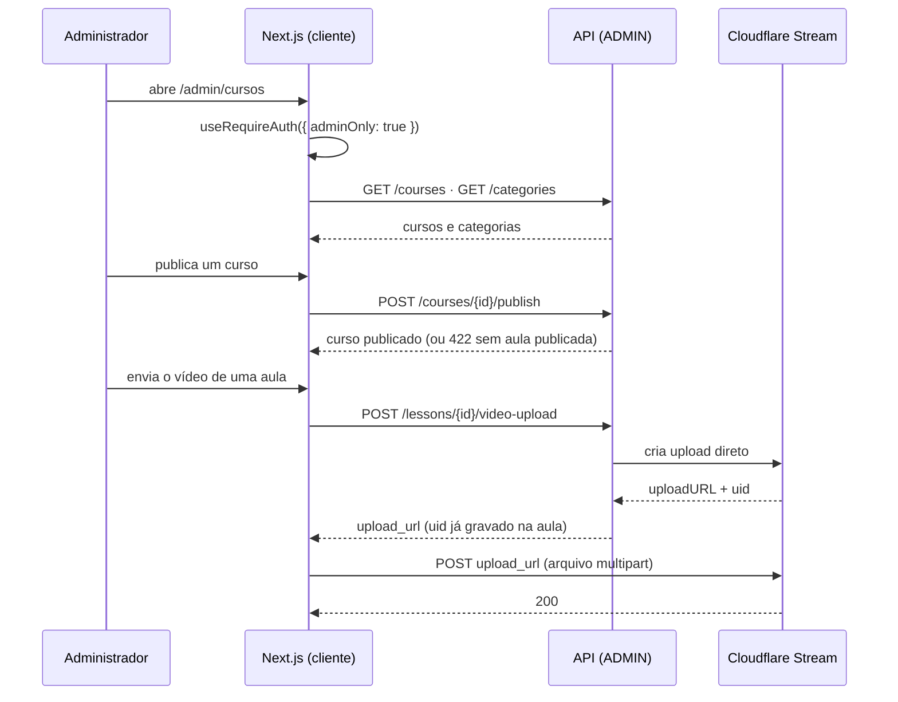

**Telas e endpoints consumidos:**

| Tela | Rota | Endpoints |
|---|---|---|
| Categorias | `/admin/categorias` | `GET` · `POST` · `PATCH` · `DELETE /categories` |
| Cursos | `/admin/cursos` | `GET` · `POST /courses`, `POST /courses/{id}/publish` · `/unpublish`, `DELETE` |
| Curso e aulas | `/admin/cursos/{id}` | `GET` · `PATCH /courses/{id}`, `GET` · `POST` · `PATCH` · `DELETE /lessons`, `POST /lessons/{id}/video-upload` |

**Decisões relevantes:**

- O guard (`useRequireAuth({ adminOnly: true })`) é apenas de **interface**: esconde o painel de
  quem não é ADMIN e redireciona para `/dashboard`. A API revalida o papel em cada chamada (403).
- Publicar um curso exige ao menos uma aula publicada — o `422` do backend é exibido como aviso
  na própria tela, sem tratar a regra novamente no cliente.
- O vídeo é enviado **direto do navegador** para a Cloudflare (`POST` multipart no `uploadURL`,
  via `lib/cloudflare-upload.ts`, que usa `XMLHttpRequest` para reportar o progresso). O arquivo
  nunca passa pelo backend. Esse método cobre arquivos até 200 MB — acima disso a Cloudflare
  exige o protocolo TUS.
- O `uid` do vídeo é gravado na aula **antes** do envio do arquivo; por isso a lista é recarregada
  ao final do upload para refletir o estado "Enviado".
- A gestão de aulas fica na página do curso (`/admin/cursos/{id}`), mantendo a lista de cursos
  enxuta e separando "catálogo" de "conteúdo".

---

### 3.10 Pagamentos com Mercado Pago (implementado na SPRINT 4)

O fluxo conceitual está na seção 3.2; aqui está a implementação. A regra que organiza todo o
módulo é a mesma: **quem libera acesso é o webhook validado**, nunca o retorno do navegador.
Por isso `POST /purchases` apenas cria a compra e o endereço de pagamento — a matrícula nasce
do lado do servidor, quando o gateway confirma o pagamento.

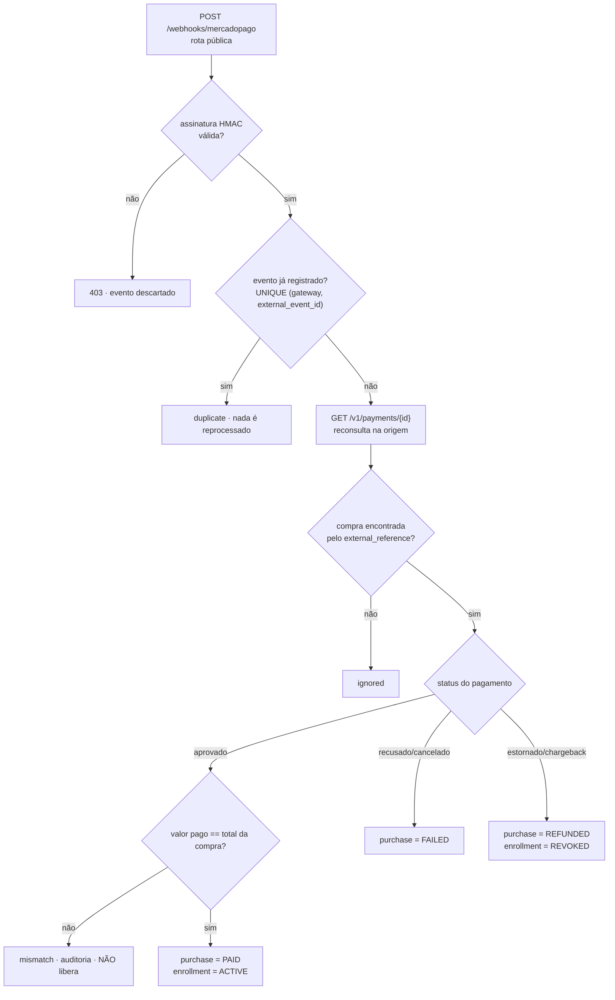

**Endpoints:**

| Método | Rota | Acesso exigido | Descrição |
|---|---|---|---|
| `POST` | `/api/v1/purchases` | autenticado + e-mail verificado | Cria a compra (`PENDING`) e devolve `init_point` (checkout) — ver 3.2 |
| `GET` | `/api/v1/purchases` | autenticado + e-mail verificado | Histórico de compras do usuário, da mais recente para a mais antiga |
| `POST` | `/api/v1/webhooks/mercadopago` | **público** (protegido por assinatura) | Notificação do gateway; **único** caminho que libera ou revoga acesso |

**Regras implementadas:**

- **Compra vinculada ao curso.** `purchases.course_id` (ver 4.3) existe para que o webhook saiba
  qual acesso liberar — sem ele a `enrollment` não teria de onde vir o `course_id`.
- **Curso inexistente ou em rascunho:** `404`. **Já possui matrícula ativa:** `409`.
- **Curso gratuito (`price = 0`):** o acesso é liberado na hora (`_grant_free_access`) — compra
  `PAID`, pagamento `APPROVED`, matrícula `ACTIVE` — e o checkout **não** é aberto
  (`requires_payment = false`, `init_point` nulo).
- **Idempotência:** o evento é registrado em `webhook_events` com `UNIQUE (gateway,
  external_event_id)`. A gravação usa um *savepoint* (`db.begin_nested()`), de modo que uma
  corrida entre notificações iguais não invalida a transação principal — o perdedor recebe
  `duplicate` e nada é reprocessado.
- **Nunca confiar no corpo da notificação:** todo evento é **reconsultado** em
  `GET /v1/payments/{id}`. Os dados que valem são os da origem, não os do payload recebido.
- **Valor divergente não libera acesso:** se o pagamento aprovado tem `transaction_amount`
  diferente de `purchases.total_amount`, o evento é marcado como `mismatch`, grava auditoria
  (`payment.amount_mismatch`) e a compra **continua pendente**.
- **Assinatura:** `x-signature` é validada por HMAC-SHA256 sobre o manifesto
  `id:<data_id>;request-id:<x-request-id>;ts:<ts>;` com `MERCADO_PAGO_WEBHOOK_SECRET`.
  Sem o secret configurado a validação é dispensada (facilita o desenvolvimento local com
  túnel), mas continua obrigatória em produção.
- **Estorno/chargeback:** a compra vira `REFUNDED` e a matrícula é marcada como `REVOKED` —
  o curso deixa de aparecer em `/me/courses` (ver 3.8).
- **Frontend:** o botão de compra ([buy-course-button.tsx](file:///c:/Users/c13_1/Projetos/OestudoLiberta/frontend/src/components/checkout/buy-course-button.tsx))
  chama `POST /purchases` e redireciona ao `init_point`; a página `/compras/retorno` apenas
  informa o estado da compra e **não** libera nada.

**Configuração necessária:** `MERCADO_PAGO_ACCESS_TOKEN` (ausente → `503`), `MERCADO_PAGO_WEBHOOK_SECRET`
e `MERCADO_PAGO_NOTIFICATION_URL` (URL pública do webhook; em desenvolvimento exige túnel, pois
o gateway não alcança `localhost`). `FRONTEND_BASE_URL` define os `back_urls` de retorno.

---

### 3.11 Aprendizagem e progresso (implementado na SPRINT 5)

Esta etapa fecha o ciclo do aluno: registra **onde ele parou**, consolida **indicadores** e
permite **retomar** o estudo. A regra central é que **só o backend decide a conclusão de uma
aula** — o player não tem como ler `currentTime` de um `iframe` de outro domínio, então envia
batidas periódicas (*heartbeat*) do tempo assistido e o servidor decide se a aula terminou.

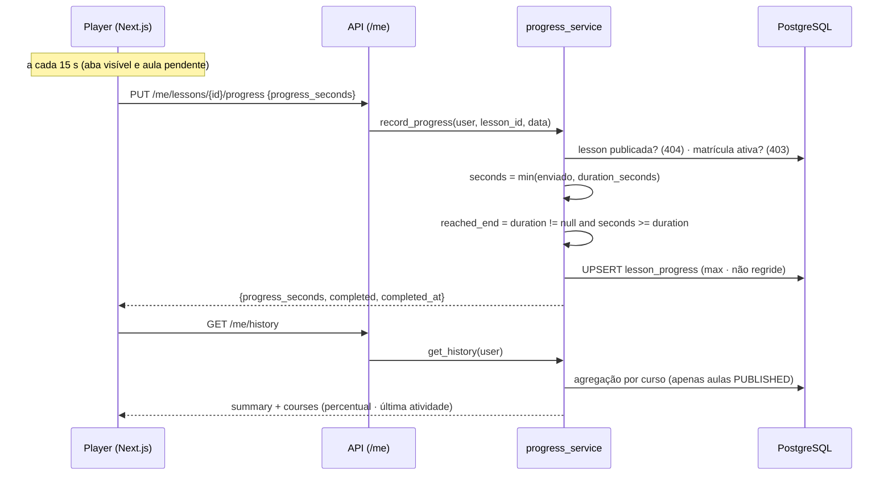

**Endpoints:**

| Método | Rota | Acesso exigido | Descrição |
|---|---|---|---|
| `PUT` | `/api/v1/me/lessons/{lesson_id}/progress` | autenticado + e-mail verificado + matrícula `ACTIVE` | Registra o progresso da aula e devolve o estado consolidado |
| `GET` | `/api/v1/me/history` | autenticado + e-mail verificado | Indicadores de aprendizagem e histórico de cursos |

**Regras implementadas:**

- **Aula precisa existir e estar publicada:** fora disso `404` — uma aula em rascunho não é
  sequer visível ao aluno.
- **Matrícula `ACTIVE` obrigatória:** sem acesso liberado (por compra, ver 3.10) a resposta é
  `403`, mesmo que o aluno conheça o `lesson_id`.
- **Progresso nunca regride:** a gravação usa `progress_seconds = max(novo, atual)`. Um
  *heartbeat* atrasado ou uma reabertura da página não apaga o que já foi assistido.
- **Tempo limitado à duração real:** `progress_seconds` é truncado em `lessons.duration_seconds`
  (quando definido), impedindo "inflar" o tempo assistido pelo cliente.
- **Conclusão automática:** com `duration_seconds` definida, atingir o fim da aula
  (`seconds >= duration`) marca `completed_at`. Em aulas sem duração informada, o aluno pode
  concluir manualmente pelo botão "Marcar aula como concluída" (`completed: true`).
- **Conclusão não é desfeita:** `completed_at` é gravado uma única vez e preservado em
  regravações posteriores.
- **Percentual medido contra o que o aluno vê:** a contagem considera **apenas aulas
  `PUBLISHED`** (`lesson_progress_repository.aggregate_by_course`), de modo que um rascunho
  criado pelo administrador não "abaixa" o progresso de ninguém.
- **Uma linha por aluno/aula:** o `UNIQUE (user_id, lesson_id)` (ver 4.3) permite `UPSERT`
  idempotente.
- **Histórico ordenado por atividade:** os cursos são listados do mais recentemente estudado
  para o mais antigo (desempate por `id`); sem atividade, aparece no fim.

**Indicadores do histórico (`LearningSummaryRead`):** `courses_owned`, `courses_completed`,
`lessons_completed`, `lessons_available` (soma das aulas publicadas dos cursos liberados) e
`watched_seconds` (tempo assistido acumulado).

**Frontend:**

- **Player** ([player-content.tsx](file:///c:/Users/c13_1/Projetos/OestudoLiberta/frontend/src/app/dashboard/cursos/%5BcourseId%5D/player-content.tsx)):
  *heartbeat* de 15 s (`PUT /me/lessons/{id}/progress`), barra de progresso no cabeçalho,
  selo nas aulas concluídas, botão de conclusão manual e **retomada automática** na primeira
  aula não concluída — a "continuidade de aprendizagem".
- **Card de curso** ([my-course-card.tsx](file:///c:/Users/c13_1/Projetos/OestudoLiberta/frontend/src/components/learning/my-course-card.tsx)):
  exibe `progress_percent` e troca o rótulo para **Continuar** quando o curso já foi iniciado.
- **Página de histórico** ([historico/page.tsx](file:///c:/Users/c13_1/Projetos/OestudoLiberta/frontend/src/app/dashboard/historico/page.tsx)):
  cards de indicadores, lista de cursos com percentual, data da última atividade e ação
  (Começar / Continuar / Revisar).

---

## 4. Modelagem do banco de dados (PostgreSQL)

**Hierarquia de conteúdo:** `CATEGORIA → CURSO → AULA → VÍDEO`. O vídeo é referenciado por
`lessons.video_uid`, apontando para a Cloudflare Stream — **nunca** um arquivo dentro do banco.

### 4.1 Convenções adotadas

| Convenção | Escolha | Motivo |
|---|---|---|
| Nomes de tabela | plural em `snake_case` (`lesson_progress`) | Consistência e legibilidade |
| Chave primária | `id bigint GENERATED BY DEFAULT AS IDENTITY` | Índice compacto e sequencial, sem `BIGSERIAL` legado |
| Instantes | `timestamptz` com `DEFAULT now()` | Fuso horário explícito, sem ambiguidade |
| Valores monetários | `numeric(10,2)` | Precisão exata (nunca `float`) |
| Domínios fechados (`status`, `role`) | `varchar` + `CHECK` | **Decisão:** evita as dores de migração dos enums nativos do PostgreSQL |
| `updated_at` | Atualizado pela aplicação (`onupdate`) | Sem gatilhos (triggers) no banco |
| Exclusão | `ON DELETE RESTRICT` por padrão | Preserva histórico financeiro e de auditoria |
| Senhas | **não existem** nesta base | A credencial vive exclusivamente no Firebase Authentication |

### 4.2 Diagrama entidade-relacionamento

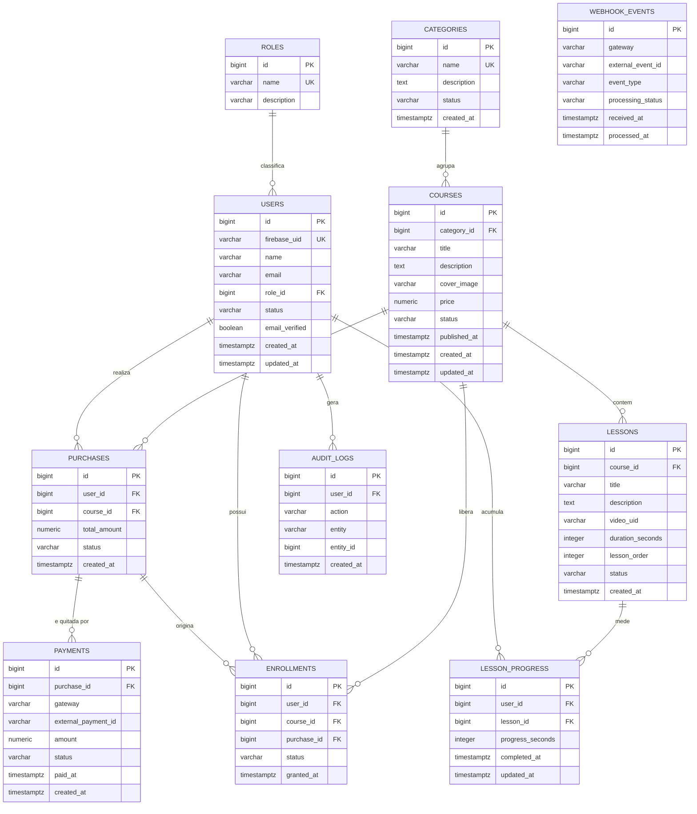

### 4.3 Dicionário de dados

#### `roles` — perfis de acesso

| Coluna | Tipo | Nulo | Default | Regra |
|---|---|---|---|---|
| `id` | `bigint` | não | identity | **PK** |
| `name` | `varchar(30)` | não | — | **UNIQUE**, `CHECK name IN ('ADMIN','STUDENT')` |
| `description` | `varchar(255)` | sim | `NULL` | Texto livre |

> **Dados iniciais (seed):** `ADMIN` e `STUDENT`. Todo novo usuário recebe `STUDENT`.

#### `users` — usuários da plataforma

| Coluna | Tipo | Nulo | Default | Regra |
|---|---|---|---|---|
| `id` | `bigint` | não | identity | **PK** |
| `firebase_uid` | `varchar(128)` | não | — | **UNIQUE** — ligação com o Firebase |
| `name` | `varchar(150)` | não | — | — |
| `email` | `varchar(254)` | não | — | **UNIQUE** sobre `lower(email)` |
| `role_id` | `bigint` | não | — | **FK** → `roles(id)` · `ON DELETE RESTRICT` |
| `status` | `varchar(20)` | não | `'ACTIVE'` | `CHECK IN ('ACTIVE','INACTIVE','BLOCKED')` |
| `email_verified` | `boolean` | não | `false` | Espelho do estado do Firebase |
| `created_at` | `timestamptz` | não | `now()` | — |
| `updated_at` | `timestamptz` | não | `now()` | Atualizado pela aplicação |

#### `categories` — categorias de cursos

| Coluna | Tipo | Nulo | Default | Regra |
|---|---|---|---|---|
| `id` | `bigint` | não | identity | **PK** |
| `name` | `varchar(120)` | não | — | **UNIQUE** |
| `description` | `text` | sim | `NULL` | — |
| `status` | `varchar(20)` | não | `'ACTIVE'` | `CHECK IN ('ACTIVE','INACTIVE')` |
| `created_at` | `timestamptz` | não | `now()` | — |

#### `courses` — cursos

| Coluna | Tipo | Nulo | Default | Regra |
|---|---|---|---|---|
| `id` | `bigint` | não | identity | **PK** |
| `category_id` | `bigint` | não | — | **FK** → `categories(id)` · `ON DELETE RESTRICT` |
| `title` | `varchar(200)` | não | — | — |
| `description` | `text` | sim | `NULL` | — |
| `cover_image` | `varchar(500)` | sim | `NULL` | URL no Cloud Storage |
| `price` | `numeric(10,2)` | não | `0.00` | `CHECK price >= 0` |
| `status` | `varchar(20)` | não | `'DRAFT'` | `CHECK IN ('DRAFT','PUBLISHED','ARCHIVED')` |
| `published_at` | `timestamptz` | sim | `NULL` | Preenchido ao publicar |
| `created_at` | `timestamptz` | não | `now()` | — |
| `updated_at` | `timestamptz` | não | `now()` | Atualizado pela aplicação |

#### `lessons` — aulas

| Coluna | Tipo | Nulo | Default | Regra |
|---|---|---|---|---|
| `id` | `bigint` | não | identity | **PK** |
| `course_id` | `bigint` | não | — | **FK** → `courses(id)` · `ON DELETE CASCADE` |
| `title` | `varchar(200)` | não | — | — |
| `description` | `text` | sim | `NULL` | — |
| `video_uid` | `varchar(200)` | sim | `NULL` | UID na Cloudflare Stream |
| `duration_seconds` | `integer` | sim | `NULL` | `CHECK 0 <= duration_seconds <= 900` (máx. 15 min) |
| `lesson_order` | `integer` | não | `1` | `CHECK lesson_order > 0` · **UNIQUE** com `course_id` |
| `status` | `varchar(20)` | não | `'DRAFT'` | `CHECK IN ('DRAFT','PUBLISHED','ARCHIVED')` |
| `created_at` | `timestamptz` | não | `now()` | — |
| `material_url` | `varchar(500)` | sim | `NULL` | Material complementar opcional (Cloud Storage) |

#### `purchases` — compras

| Coluna | Tipo | Nulo | Default | Regra |
|---|---|---|---|---|
| `id` | `bigint` | não | identity | **PK** |
| `user_id` | `bigint` | não | — | **FK** → `users(id)` · `ON DELETE RESTRICT` |
| `course_id` | `bigint` | não | — | **FK** → `courses(id)` · `ON DELETE RESTRICT` · índice |
| `total_amount` | `numeric(10,2)` | não | `0.00` | `CHECK total_amount >= 0` |
| `status` | `varchar(20)` | não | `'PENDING'` | `CHECK IN ('PENDING','PAID','FAILED','CANCELED','REFUNDED')` |
| `created_at` | `timestamptz` | não | `now()` | — |

> `course_id` (adicionado na SPRINT 4) é o que permite ao webhook saber **qual** acesso liberar:
> a `enrollment` só nasce depois do pagamento, então o vínculo não pode depender dela.
> Cada compra paga origina exatamente uma `enrollment` (modelo de pagamento por curso).

#### `payments` — pagamentos

| Coluna | Tipo | Nulo | Default | Regra |
|---|---|---|---|---|
| `id` | `bigint` | não | identity | **PK** |
| `purchase_id` | `bigint` | não | — | **FK** → `purchases(id)` · `ON DELETE CASCADE` |
| `gateway` | `varchar(30)` | não | `'MERCADO_PAGO'` | `CHECK IN ('MERCADO_PAGO')` |
| `external_payment_id` | `varchar(120)` | sim | `NULL` | ID no gateway |
| `amount` | `numeric(10,2)` | não | `0.00` | `CHECK amount >= 0` |
| `status` | `varchar(20)` | não | `'PENDING'` | `CHECK IN ('PENDING','IN_PROCESS','APPROVED','REJECTED','REFUNDED')` |
| `paid_at` | `timestamptz` | sim | `NULL` | Preenchido quando aprovado |
| `created_at` | `timestamptz` | não | `now()` | — |

> **UNIQUE composta** `(gateway, external_payment_id)` — impede registrar duas vezes o mesmo pagamento.

#### `enrollments` — liberação de acesso

| Coluna | Tipo | Nulo | Default | Regra |
|---|---|---|---|---|
| `id` | `bigint` | não | identity | **PK** |
| `user_id` | `bigint` | não | — | **FK** → `users(id)` · `ON DELETE RESTRICT` |
| `course_id` | `bigint` | não | — | **FK** → `courses(id)` · `ON DELETE RESTRICT` |
| `purchase_id` | `bigint` | não | — | **FK** → `purchases(id)` · `ON DELETE RESTRICT` |
| `status` | `varchar(20)` | não | `'ACTIVE'` | `CHECK IN ('ACTIVE','REVOKED')` |
| `granted_at` | `timestamptz` | não | `now()` | — |

> **UNIQUE composta** `(user_id, course_id)` — é o que **impede compras/duplicidades de acesso**.
> É esta tabela que responde "o aluno pode assistir a este curso?".

#### `lesson_progress` — progresso do aluno

| Coluna | Tipo | Nulo | Default | Regra |
|---|---|---|---|---|
| `id` | `bigint` | não | identity | **PK** |
| `user_id` | `bigint` | não | — | **FK** → `users(id)` · `ON DELETE CASCADE` |
| `lesson_id` | `bigint` | não | — | **FK** → `lessons(id)` · `ON DELETE CASCADE` |
| `progress_seconds` | `integer` | não | `0` | `CHECK progress_seconds >= 0` |
| `completed_at` | `timestamptz` | sim | `NULL` | Preenchido ao concluir a aula |
| `updated_at` | `timestamptz` | não | `now()` | Atualizado a cada envio de progresso |

> **UNIQUE composta** `(user_id, lesson_id)` — uma linha por aluno/aula (permite `UPSERT`).
> O progresso **nunca regride** (`max`) e `completed_at` é gravado uma única vez; as métricas
> por curso contam **apenas aulas `PUBLISHED`** (ver 3.11).

#### `webhook_events` — eventos recebidos dos gateways

| Coluna | Tipo | Nulo | Default | Regra |
|---|---|---|---|---|
| `id` | `bigint` | não | identity | **PK** |
| `gateway` | `varchar(30)` | não | — | `CHECK IN ('MERCADO_PAGO')` |
| `external_event_id` | `varchar(150)` | não | — | ID do evento no gateway |
| `event_type` | `varchar(80)` | não | — | Ex.: `payment.updated` |
| `processing_status` | `varchar(20)` | não | `'RECEIVED'` | `CHECK IN ('RECEIVED','PROCESSED','FAILED','IGNORED')` |
| `received_at` | `timestamptz` | não | `now()` | — |
| `processed_at` | `timestamptz` | sim | `NULL` | — |

> **UNIQUE composta** `(gateway, external_event_id)` — **garantia de idempotência**: o mesmo
> webhook reenviado pelo gateway é ignorado, nunca processado duas vezes.

#### `audit_logs` — auditoria administrativa

| Coluna | Tipo | Nulo | Default | Regra |
|---|---|---|---|---|
| `id` | `bigint` | não | identity | **PK** |
| `user_id` | `bigint` | sim | `NULL` | **FK** → `users(id)` · `ON DELETE SET NULL` |
| `action` | `varchar(80)` | não | — | Ex.: `COURSE_PUBLISHED` |
| `entity` | `varchar(60)` | não | — | Ex.: `courses` |
| `entity_id` | `bigint` | sim | `NULL` | Id do registro afetado |
| `created_at` | `timestamptz` | não | `now()` | — |

> `ON DELETE SET NULL` preserva o registro de auditoria mesmo se o usuário for removido.

### 4.4 Índices

| Tabela | Índice | Colunas | Objetivo |
|---|---|---|---|
| `users` | `ix_users_role_id` | `role_id` | Filtrar por perfil |
| `users` | `uq_users_email_lower` | `lower(email)` (**UNIQUE**) | Impedir e-mail duplicado com caixa diferente |
| `courses` | `ix_courses_category_id` | `category_id` | Catálogo por categoria |
| `courses` | `ix_courses_status` | `status` | Filtrar publicados |
| `lessons` | `ix_lessons_course_id` | `course_id` | Montar a trilha do curso |
| `purchases` | `ix_purchases_user_id` | `user_id` | Histórico de compras |
| `purchases` | `ix_purchases_status` | `status` | Conciliar pendentes |
| `purchases` | `ix_purchases_course_id` | `course_id` | Compras de um curso |
| `payments` | `ix_payments_purchase_id` | `purchase_id` | Pagamentos da compra |
| `enrollments` | `ix_enrollments_course_id` | `course_id` | Alunos do curso |
| `enrollments` | `ix_enrollments_purchase_id` | `purchase_id` | Rastrear origem do acesso |
| `lesson_progress` | `ix_lesson_progress_user_id` | `user_id` | Progresso por aluno |
| `audit_logs` | `ix_audit_logs_user_id` | `user_id` | Auditoria por administrador |
| `audit_logs` | `ix_audit_logs_entity` | `(entity, entity_id)` | Histórico por registro |

Índices de colunas de chave estrangeira são criados automaticamente pelo Alembic via
`index=True` no modelo — **não é necessário criar manualmente**.

### 4.5 Restrições de integridade (resumo)

| Tipo | Restrição | Efeito |
|---|---|---|
| **Unicidade** | `users.firebase_uid`, `users.lower(email)`, `roles.name`, `categories.name` | Não há duplicidade de identidade |
| **Unicidade** | `lessons(course_id, lesson_order)` | Duas aulas na mesma posição do curso |
| **Unicidade** | `enrollments(user_id, course_id)` | **Bloqueia compra duplicada do mesmo curso** |
| **Unicidade** | `lesson_progress(user_id, lesson_id)` | Uma linha de progresso por aluno/aula |
| **Unicidade** | `payments(gateway, external_payment_id)` | Pagamento não é registrado duas vezes |
| **Unicidade** | `webhook_events(gateway, external_event_id)` | **Idempotência dos webhooks** |
| **Domínio** | `CHECK` em todos os campos `status`, `role.name` e `gateway` | Nenhum valor inválido entra na base |
| **Faixa** | `CHECK price >= 0`, `amount >= 0`, `total_amount >= 0` | Não existe valor negativo |
| **Faixa** | `CHECK duration_seconds BETWEEN 0 AND 900` | Reforça no banco a regra "aula de até 15 minutos" |
| **Integridade referencial** | FKs com `RESTRICT` / `CASCADE` / `SET NULL` conforme a tabela | Nada órfão e histórico financeiro preservado |

### 4.6 Estratégia de migração (Alembic)

- **Uma migração por alteração de esquema**, sempre com `upgrade()` e `downgrade()` implementados.
- **Nomes determinísticos de constraints** via `naming_convention` no metadata do SQLAlchemy —
  sem isso, o PostgreSQL gera nomes aleatórios e o `downgrade()` quebra:

```python
NAMING_CONVENTION = {
    "ix": "ix_%(table_name)s_%(column_0_name)s",
    "uq": "uq_%(table_name)s_%(column_0_name)s",
    "ck": "ck_%(table_name)s_%(constraint_name)s",
    "fk": "fk_%(table_name)s_%(column_0_name)s_%(referred_table_name)s",
    "pk": "pk_%(table_name)s",
}
```

- **Seed de `roles`** feito por migração de dados (idempotente), garantindo `ADMIN` e `STUDENT`
  em qualquer ambiente.
- **Nunca** alterar uma migração já aplicada em produção: cria-se sempre uma nova revisão.
- Fluxo de trabalho:

```powershell
alembic revision --autogenerate -m "descricao da mudanca"   # gera o arquivo
# revisar o arquivo gerado antes de aplicar
alembic upgrade head                                        # aplica
alembic downgrade -1                                        # desfaz a ultima
alembic current                                             # revisao aplicada
alembic history                                             # historico
```

- Em produção (Cloud Run), as migrações rodam como **etapa explícita do deploy** — nunca
  automaticamente na inicialização da aplicação.

#### 4.6.1 Revisões aplicadas

| Revisão | Arquivo | O que faz |
|---|---|---|
| `805089c00163` | [805089c00163_estrutura_inicial.py](file:///c:/Users/c13_1/Projetos/OestudoLiberta/backend/migrations/versions/805089c00163_estrutura_inicial.py) | Cria as 11 tabelas, índices e constraints |
| `74efadc0de0e` | [74efadc0de0e_seed_roles.py](file:///c:/Users/c13_1/Projetos/OestudoLiberta/backend/migrations/versions/74efadc0de0e_seed_roles.py) | Seed idempotente de `ADMIN` e `STUDENT` |
| `35d974a96c17` | [35d974a96c17_vincula_compra_ao_curso.py](file:///c:/Users/c13_1/Projetos/OestudoLiberta/backend/migrations/versions/35d974a96c17_vincula_compra_ao_curso.py) | Adiciona `purchases.course_id` (NOT NULL) + índice + FK — ver 3.10 |

**Configuração do Alembic:**

- [alembic.ini](file:///c:/Users/c13_1/Projetos/OestudoLiberta/backend/alembic.ini) — `script_location = migrations`,
  `prepend_sys_path = .`. **Não** contém a URL do banco (nenhuma credencial é versionada).
- [migrations/env.py](file:///c:/Users/c13_1/Projetos/OestudoLiberta/backend/migrations/env.py) — injeta a URL a partir de
  `get_settings().sqlalchemy_database_uri` e define `target_metadata = Base.metadata`
  (com `compare_type` e `compare_server_default` ligados).
- O seed usa `INSERT ... ON CONFLICT (name) DO NOTHING`: pode ser reaplicado sem efeito colateral.

**Verificação executada:** `upgrade head` → 11 tabelas + `alembic_version`; `downgrade base`
→ apenas `alembic_version`; `upgrade head` novamente → tabelas recriadas e papéis re-semeados.

### 4.7 Domínios fechados (enums) — implementação

Os domínios fechados (`role`, `status`, `gateway`) são definidos como `StrEnum` em
[app/core/enums.py](file:///c:/Users/c13_1/Projetos/OestudoLiberta/backend/app/core/enums.py) e persistidos como
`varchar` + `CHECK` (nunca `ENUM` nativo do PostgreSQL — ver justificativa em 4.1).

O helper `enum_type()` em [app/models/base.py](file:///c:/Users/c13_1/Projetos/OestudoLiberta/backend/app/models/base.py#L48-L62)
converte cada enum nessa representação:

| Enum | Coluna(s) | Valores |
|---|---|---|
| `RoleName` | `roles.name` | `ADMIN`, `STUDENT` |
| `UserStatus` | `users.status` | `ACTIVE`, `INACTIVE`, `BLOCKED` |
| `CategoryStatus` | `categories.status` | `ACTIVE`, `INACTIVE` |
| `CourseStatus` | `courses.status` | `DRAFT`, `PUBLISHED`, `ARCHIVED` |
| `LessonStatus` | `lessons.status` | `DRAFT`, `PUBLISHED`, `ARCHIVED` |
| `PurchaseStatus` | `purchases.status` | `PENDING`, `PAID`, `FAILED`, `CANCELED`, `REFUNDED` |
| `PaymentStatus` | `payments.status` | `PENDING`, `IN_PROCESS`, `APPROVED`, `REJECTED`, `REFUNDED` |
| `Gateway` | `payments.gateway`, `webhook_events.gateway` | `MERCADO_PAGO` |
| `EnrollmentStatus` | `enrollments.status` | `ACTIVE`, `REVOKED` |
| `WebhookStatus` | `webhook_events.processing_status` | `RECEIVED`, `PROCESSED`, `FAILED`, `IGNORED` |

Cada `CHECK` recebe nome determinístico pela `naming_convention` (ex.: `ck_users_user_status`),
o que mantém o `downgrade()` das migrações funcional.

---

## 5. Ambientes

| Aspecto | Desenvolvimento (agora) | Produção (SPRINT 6) |
|---|---|---|
| Backend | `uvicorn --reload` na máquina local | Cloud Run (container) |
| Banco | PostgreSQL 18 local (`D:\postgre`) | Cloud SQL (PostgreSQL) |
| Arquivos | Disco local | Cloud Storage (bucket preparado; integração da aplicação pendente) |
| Vídeos | Cloudflare Stream | Cloudflare Stream |
| Segredos | arquivo `.env` (local, não versionado) | Secret Manager |
| Logs | console | Cloud Logging |
| HTTPS | não (localhost) | sim (domínio + TLS gerenciado) |
| CORS | `http://localhost:3000` | domínio oficial |

---

## 6. Ordem de implementação (roadmap)

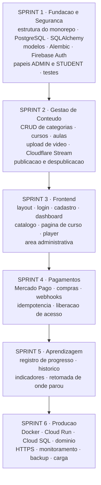

### 6.1 Dependências entre etapas

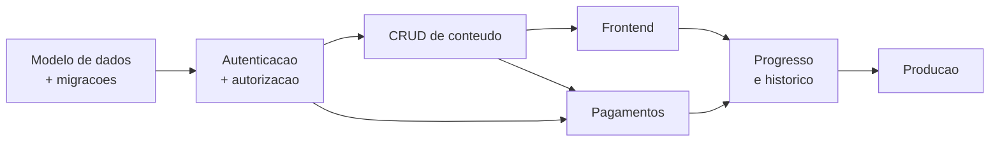

Cada seta é uma **dependência real**: por exemplo, não é possível implementar pagamentos sem
o modelo de dados e a autorização prontos, nem progresso sem a liberação de acesso por compra.

### 6.2 Estado atual

| Etapa | Escopo | Situação |
|---|---|---|
| 1.1 | Estrutura do monorepo, Git, `.env`, `docker-compose` | Concluída |
| 1.2 | Ambiente virtual, dependências, config, conexão com PostgreSQL, `/health` | Concluída |
| 1.3 | Modelos SQLAlchemy + Alembic (migração inicial) | Concluída |
| 1.4 | Firebase Authentication + autorização ADMIN/STUDENT | Concluída |
| 2 | Gestão de conteúdo + Cloudflare Stream | Concluída |
| 3.1 | Frontend: layout, login, cadastro, recuperação e verificação de e-mail | Concluída |
| 3.2 | Frontend: catálogo (home, listagem, curso) + API pública `/catalog` — ver 3.7 | Concluída |
| 3.3 | Frontend: dashboard do aluno (meus cursos, player) + API `/me` — ver 3.8 | Concluída |
| 3.4 | Frontend: área administrativa (cursos, categorias, aulas e vídeos) — ver 3.9 | Concluída |
| 4 | Pagamentos Mercado Pago (checkout, webhook idempotente e liberação de acesso) — ver 3.10 | Concluída |
| 5 | Aprendizagem e progresso (registro, indicadores, cursos concluídos e continuidade) — ver 3.11 | Concluída |
| 6 | Produção no Google Cloud | **Em andamento** |

O Docker local (PostgreSQL, FastAPI e Next.js) foi buildado e validado. Scripts
PowerShell com gcloud, workflows de CI/deploy e o runbook estão preparados em
[SPRINT 6 — Google Cloud](sprint-6-google-cloud.md). O deploy real permanece
pendente: projeto GCP, faturamento, autenticação e configuração de produção
ainda não foram fornecidos.

O detalhamento das pendências e critérios de aceite das SPRINTS 1 a 6 está no
[roadmap revisado](04-roadmap.md). “Concluída” na tabela acima indica
implementação principal, não homologação de provedores externos em produção.

---

## 7. Segurança transversal

Aplicada em **todas** as camadas, não em uma etapa isolada:

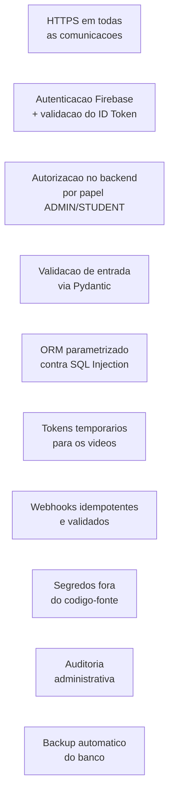

**Princípio central:** nada que o frontend envia é confiado. Toda regra é revalidada no backend.

---

## 8. Glossário rápido

| Termo | Significado |
|---|---|
| **Monólito modular** | Uma aplicação única, organizada internamente em módulos bem separados |
| **ID Token** | Credencial assinada pelo Firebase que prova quem é o usuário |
| **Admin SDK** | Biblioteca oficial do Firebase usada no backend para validar tokens |
| **Webhook** | Chamada que o serviço externo (Mercado Pago) faz ao nosso backend para avisar um evento |
| **Idempotência** | Garantir que o mesmo evento processado duas vezes não duplique efeitos |
| **Migration (Alembic)** | Script versionado que aplica alterações no banco de dados |
| **Enrollment** | Vínculo que dá ao aluno o direito de acessar um curso |
