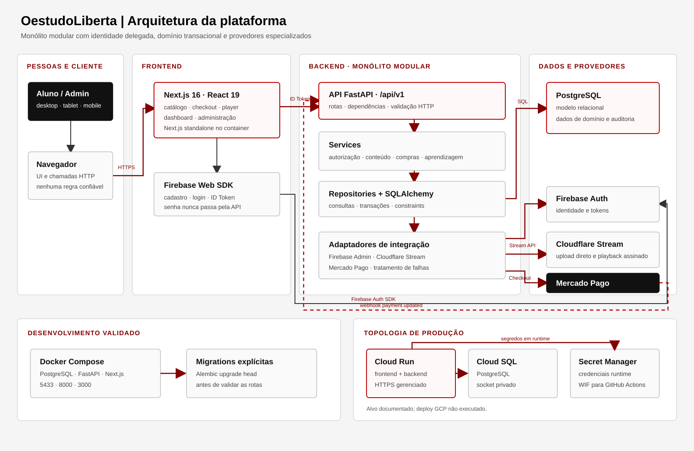
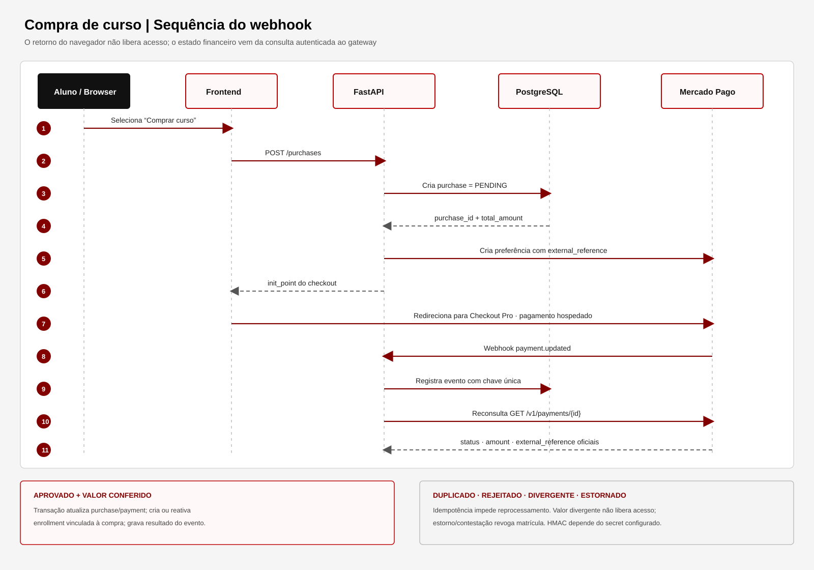
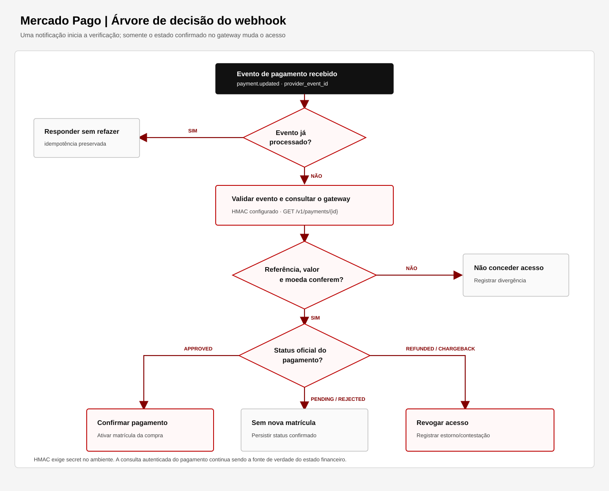
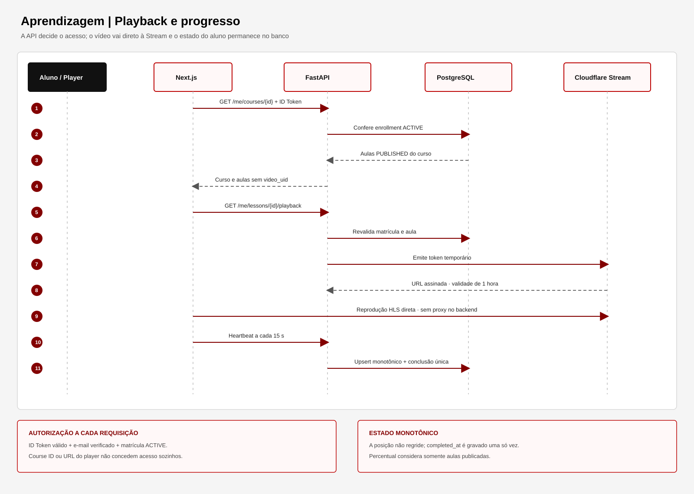
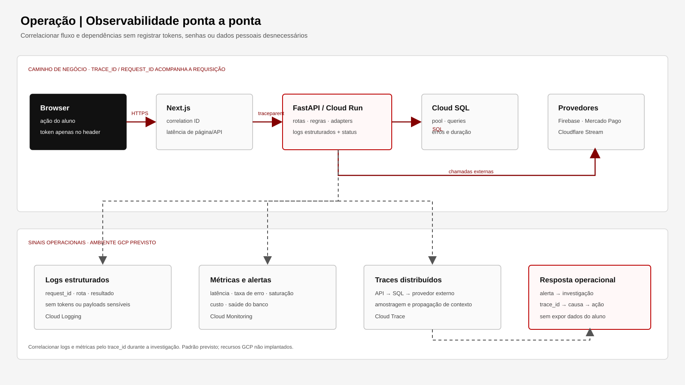
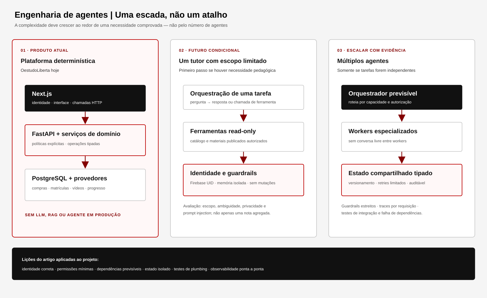

# OestudoLiberta — Guia Técnico do Projeto

**Versão:** 1.0 (diagramas vetoriais)  
**Revisado em:** 14/11/2026  
**Público:** desenvolvimento, operação e pessoas que ingressam no projeto

Este guia apresenta o produto e os limites entre frontend, backend, dados e
provedores externos. A referência de engenharia de agentes é usada como lente
para decisões de arquitetura e qualidade, não como afirmação de que o produto
já contenha agentes de IA.

## 1. Produto e Escopo

OestudoLiberta é uma plataforma de cursos online no modelo **pay-per-course**.
Administradores organizam e publicam cursos; alunos descobrem cursos, compram
acesso, assistem às aulas e acompanham seu progresso.

Responsabilidades principais:

- **Frontend:** apresentação, navegação, autenticação do usuário e chamadas HTTP.
- **Backend:** fonte de verdade para autorização, regras de negócio, pagamentos,
  progresso e integrações.
- **PostgreSQL:** persistência relacional e garantias de integridade.
- **Firebase Authentication:** identidade, senha, verificação de e-mail e ID
  Tokens.
- **Cloudflare Stream:** upload, transcodificação, tokens temporários e entrega
  de vídeo.
- **Mercado Pago:** checkout e notificações de pagamento.

O estilo atual é um **monólito modular**. Não há LLM, RAG ou agente de IA no
fluxo de produto existente.

## 2. Arquitetura



**Figura 1.** Componentes, limites e integrações. Setas vermelhas contínuas
representam chamadas; a seta vermelha tracejada representa o webhook; as áreas
inferiores distinguem o ambiente local validado do alvo de produção.

### Método visual

A referência mostra diferentes modelos para perguntas diferentes: diagrama de
componentes para arquitetura, sequência temporal para interações, fluxo de
decisão para roteamento e pipeline para avaliação/observabilidade. As imagens
do artigo não identificam qual editor ou ferramenta de desenho foi usado; por
isso, este projeto adota a linguagem visual e os tipos de diagrama, sem alegar
reproduzir a ferramenta original.

Os diagramas deste guia são SVGs editáveis e versionados em `docs/assets/`.
Cada imagem tem título, descrição acessível, fronteiras nomeadas e setas
rotuladas. Preto identifica atores/contextos; vermelho destaca fluxo de negócio
e decisões importantes; cinza representa dependências ou retorno; linhas
tracejadas indicam eventos assíncronos ou sinais de telemetria. Sequências
usam lifelines e ordem numerada; arquitetura separa responsabilidades; o
diagrama de engenharia explicita o que existe hoje versus extensões futuras.

Em desenvolvimento, `docker-compose.yml` executa PostgreSQL, backend e
frontend. Em produção, a topologia planejada separa frontend e backend em
serviços Cloud Run e usa Cloud SQL e Secret Manager. Os containers foram
validados localmente; o alvo GCP é descrito em
[SPRINT 6 — Google Cloud](sprint-6-google-cloud.md).

### Camadas do backend

| Diretório | Responsabilidade |
|---|---|
| `backend/app/api` | Rotas FastAPI, dependências e validação HTTP |
| `backend/app/schemas` | Contratos de entrada e saída via Pydantic |
| `backend/app/services` | Regras de negócio e orquestração |
| `backend/app/repositories` | Consultas e persistência |
| `backend/app/models` | Entidades e metadados SQLAlchemy |
| `backend/app/integrations` | Adaptadores Firebase, Cloudflare Stream e Mercado Pago |
| `backend/app/core` | Configuração, banco, enums e tratamento de erros |
| `backend/migrations` | Evolução de esquema com Alembic |

Regra de dependência: rotas chamam serviços; serviços aplicam políticas e
coordenam repositórios/integrações; repositórios persistem dados. O frontend
não substitui a autorização nem as validações do backend.

## 3. Fluxos de Negócio

### Identidade

1. O usuário cria conta ou entra pelo Firebase Web SDK.
2. O frontend envia o ID Token como Bearer Token.
3. O backend valida o token via Firebase Admin SDK e sincroniza o usuário por
   `firebase_uid`.
4. Novas contas recebem `STUDENT`. A promoção a `ADMIN` é controlada pelo
   `ADMIN_BOOTSTRAP_EMAIL`.
5. Rotas de aluno e administrador exigem e-mail verificado; rotas administrativas
   também exigem papel `ADMIN`.

O PostgreSQL não armazena senhas.

### Conteúdo e catálogo

1. Um administrador cria categorias, cursos e aulas.
2. Um curso nasce em `DRAFT`; publicá-lo exige pelo menos uma aula publicada.
3. A vitrine pública retorna somente categorias ativas, cursos publicados e
   aulas publicadas.
4. O upload é negociado no backend e enviado do navegador diretamente à
   Cloudflare Stream. O backend armazena o identificador do vídeo, não o arquivo.

### Compra e acesso

1. O backend cria uma compra `PENDING` e uma preferência no Mercado Pago.
2. O aluno realiza o pagamento no checkout hospedado pelo gateway.
3. O webhook é registrado idempotentemente; o backend consulta o pagamento na
   API do Mercado Pago e confere valor e referência da compra.
4. Pagamento aprovado cria ou reativa uma matrícula vinculada à compra.
   Estorno/contestação revoga o acesso.
5. O retorno do navegador, por si só, nunca libera acesso.



**Figura 2.** A API consulta o estado oficial do pagamento antes de mudar a
matrícula; duplicatas e divergências não concedem novo acesso.



**Figura 3.** O fluxo separa idempotência, verificação, reconciliação e efeitos
de domínio. A matrícula só é ativada ou revogada após conferir o estado
financeiro retornado pelo gateway.

### Aprendizagem

1. O aluno autenticado acessa uma matrícula `ACTIVE`.
2. O backend lista apenas aulas `PUBLISHED` e emite URLs temporárias para
   reprodução da Cloudflare Stream.
3. O player envia heartbeat de progresso a cada 15 segundos enquanto a aula
   está ativa.
4. O progresso avança, não regride; a conclusão é registrada uma única vez.
5. Dashboard e histórico consolidam progresso por aula e curso.



**Figura 4.** O vídeo é entregue diretamente pela Stream, enquanto o backend
mantém a autorização e o progresso confiável.

## 4. Modelo de Dados

| Entidade | Papel no domínio |
|---|---|
| `roles`, `users` | Papéis locais e identidade sincronizada com Firebase |
| `categories`, `courses`, `lessons` | Hierarquia de conteúdo e publicação |
| `purchases`, `payments` | Intenção de compra e transações do gateway |
| `enrollments` | Acesso concedido ou revogado a um curso |
| `lesson_progress` | Posição, percentual e conclusão por aluno/aula |
| `webhook_events` | Idempotência e resultado do processamento de notificações |
| `audit_logs` | Trilha de operações administrativas e financeiras relevantes |

Invariantes importantes:

- `lessons.duration_seconds` não ultrapassa 900 segundos.
- `lesson_order` é único dentro do curso.
- Matrícula ativa está vinculada a uma compra.
- Há no máximo um progresso por combinação aluno/aula.
- IDs externos de pagamento e eventos de webhook têm unicidade por gateway.
- Status e papéis usam strings com `CHECK`, não enums nativos do PostgreSQL.
- Valores financeiros usam `numeric`, e timestamps usam `timestamptz`.
- Migrações aplicadas nunca são editadas; alterações novas recebem nova revisão.

O diagrama ER, dicionário completo, índices e constraints estão em
[01-architecture.md, seção 4](01-architecture.md).

## 5. API

Todas as rotas da aplicação estão sob `/api/v1`.

| Grupo | Responsabilidade |
|---|---|
| `/auth` e `/users` | Sincronização de identidade e administração de usuários |
| `/categories`, `/courses`, `/lessons` | Gestão administrativa de conteúdo |
| `/catalog` | Vitrine pública |
| `/purchases` | Checkout e histórico de compras do usuário |
| `/webhooks/mercadopago` | Notificações públicas do gateway |
| `/me` | Cursos, reprodução, progresso e histórico do aluno |
| `/health` e `/health/db` | Saúde da aplicação e conectividade com banco |

O contrato detalhado por rota e os schemas estão descritos na arquitetura e
implementados em `backend/app/api/v1/routes` e `backend/app/schemas`.

## 6. Segurança e Limites de Confiança

| Limite | Controle |
|---|---|
| Navegador → API | TLS em produção, ID Token validado no backend e Pydantic |
| Aluno → conteúdo privado | Matrícula ativa e e-mail verificado conferidos no servidor |
| Aluno → funções administrativas | Papel ADMIN verificado em cada chamada; guard de UI não é autorização |
| API → banco | SQLAlchemy parametrizado, FKs, constraints e transações |
| API → Cloudflare | Token de API só no backend; URLs de playback temporárias |
| Mercado Pago → API | Reconsulta do pagamento na origem, idempotência e comparação de valor; a verificação HMAC depende de `MERCADO_PAGO_WEBHOOK_SECRET` estar configurado |
| Repositório → ambiente | `.env`, service-account JSON e tokens não devem ser versionados |

Segredos e configurações são carregados do ambiente local e, em produção,
devem vir do Secret Manager. O modelo local está em `.env.example`; Firebase
Web usa variáveis `NEXT_PUBLIC_*`, que são públicas e ficam incorporadas no
build do frontend.

## 7. Configuração e Execução

### Ambiente local

1. Instale Python 3.12, Node.js 26, PostgreSQL ou Docker Desktop com WSL2.
2. Copie `.env.example` para `.env` e configure os valores locais.
3. Configure `frontend/.env.local` com a configuração Web do Firebase.
4. Instale dependências e aplique migrations:

```powershell
cd backend
py -3.12 -m venv .venv
.\.venv\Scripts\Activate.ps1
pip install -r requirements.txt
alembic upgrade head
```

Para executar a stack containerizada, consulte a seção Docker do
[README](../README.md). O arquivo Compose publica frontend em `3000`, API em
`8000` e PostgreSQL em `5433` no host.

### Produção

O desenho usa Cloud Run, Cloud SQL, Artifact Registry, Secret Manager e
Workload Identity Federation para GitHub Actions. O workflow de produção é
manual, restrito à branch `main` e deve ser protegido por aprovação no
Environment `production`. Migrations são executadas por Cloud Run Job antes da
revisão do backend.

Procedimentos, variáveis, recursos e comandos estão em
[SPRINT 6 — Google Cloud](sprint-6-google-cloud.md).



**Figura 5.** Correlação entre aplicação, banco e provedores. Cloud Logging,
Monitoring e Trace representam o alvo operacional GCP, não recursos já
implantados.

## 8. Testes e Qualidade

- Backend: `pytest` cobre autenticação/autorização, catálogo, conteúdo,
  pagamento/webhook, aprendizagem e progresso.
- Banco: testes usam PostgreSQL e transações isoladas.
- Estilo backend: `ruff check .`.
- Frontend: `npm run lint` e `npm run build`.
- CI: `.github/workflows/ci.yml` executa migrations e testes backend com
  PostgreSQL de serviço, além de lint/build do frontend.
- Integrações de terceiros são simuladas nos testes automatizados; homologação
  real continua usando os ambientes e credenciais dos provedores.

## 9. Engenharia de Agentes: Aplicação da Referência

O artigo
[“Agent Engineering: Lessons from Building Three AI Agents on AWS”](https://www.linkedin.com/pulse/agent-engineering-lessons-from-building-three-ai-aws-guilherme-diwtf/)
propõe uma progressão: `prompt → ferramenta → banco`; depois um agente com
memória, recuperação e integrações; por fim vários agentes com estado
compartilhado, guardrails e observabilidade.



**Figura 6.** O produto atual é determinístico. Um tutor single-agent é uma
possível extensão; multiagentes só entram se a necessidade justificar o custo
de estado, coordenação e operação.

### O que se aplica hoje

O OestudoLiberta não chama um LLM. Portanto, a progressão não é um inventário
de componentes existentes. A lição transferível é tratar cada fronteira como
parte do sistema:

- **Identidade antes de estado:** dados de aluno são isolados pelo usuário
  autenticado; nunca se deve usar um identificador compartilhado para memória
  entre sessões.
- **Ferramentas atrás de políticas:** pagamentos, matrículas, publicação e
  playback passam por serviços do backend; um futuro modelo não deve acessar
  diretamente SQL ou credenciais dos provedores.
- **Integrações são dependências:** credenciais, versões, timeouts, erros e
  permissões precisam ser verificáveis sem depender apenas de um prompt.
- **Avaliação além da métrica:** teste de conteúdo correto também precisa
  avaliar se a resposta é segura, apropriada ao contexto e autorizada.
- **Observabilidade por fluxo:** uma operação relevante deve poder ser
  correlacionada entre API, banco e provedor, com dados pessoais minimizados.

### Se um tutor de IA for introduzido

1. Começar com um único agente de escopo limitado, preferencialmente consulta
   somente leitura ao catálogo e a aulas publicadas.
2. Expor ferramentas por serviços tipados do backend, com autorização de
   matrícula repetida em cada chamada.
3. Usar `firebase_uid` validado para qualquer memória; particionar e controlar
   retenção por usuário. Não reutilizar estado entre alunos.
4. Recuperar somente materiais cuja permissão o aluno já possui; versionar a
   fonte/index e definir quando conteúdo alterado será reindexado.
5. Versionar prompt, modelo e dependências; validar imports e configuração no
   startup/readiness, não confiar apenas no ambiente do notebook local.
6. Criar avaliações cobrindo dúvidas ambíguas, fora de escopo, prompt
   injection, conteúdo desatualizado, autorização e vazamento de dados. O
   resultado numérico é evidência, não o critério único de produto.
7. Adicionar multiagentes apenas se houver tarefas independentes e fronteiras
   claras. Preferir um registro compartilhado tipado, escrita com controle de
   versão, retries limitados, guardrails estreitos e trace por requisição a
   agentes conversando sem estado auditável.

Um tutor deve orientar, não alterar compras, pagamentos, matrículas ou
conteúdo administrativo. Essas ações continuam sendo operações determinísticas
e autorizadas do backend.

## 10. Referências do Repositório

- [Arquitetura detalhada](01-architecture.md)
- [Roadmap e critérios por sprint](04-roadmap.md)
- [Produção no Google Cloud](sprint-6-google-cloud.md)
- [Backend](../backend)
- [Frontend](../frontend)
- [CI](../.github/workflows/ci.yml)
- [Deploy de produção](../.github/workflows/deploy-production.yml)
